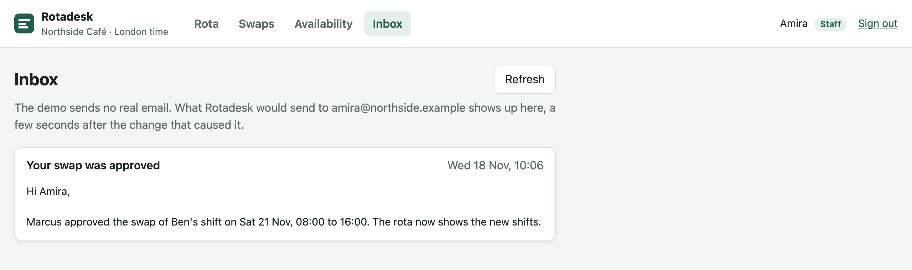

# rotadesk

[](https://github.com/mohsinaliwork686-rgb/rotadesk/actions/workflows/ci.yml)
[](LICENSE)


**Staff scheduling for small businesses, one app for many of them.** A manager builds the week's
rota and publishes it. Staff say when they can work, see their shifts, and ask a colleague to swap
one. The colleague accepts, a manager approves, and everyone affected gets an email. Each business
sees only its own staff and shifts.

ASP.NET Core minimal APIs, EF Core and PostgreSQL, ASP.NET Core Identity, and a React front end,
tested against a real PostgreSQL.

**[Try the live demo](https://rotadesk.onrender.com)**: two sample businesses, and a one-click sign-in as a manager or
as staff. It runs on a free plan that sleeps when nobody is using it, so the first visit after a
quiet spell takes about a minute.


## The problem

A café or a small shop plans its staff week by week, usually in a spreadsheet or a group chat. The
manager builds the rota, sends a screenshot, and then spends the week handling "can someone take my
Saturday?" messages. Nobody can see who has agreed to what, double bookings slip through, and
someone ends up working 50 hours because a swap was never checked.

## What it does

- **Managers** build the week: add shifts, give each to someone, and see straight away when that
  person would be on two shifts at once, go over their weekly hours, or isn't usually free. They copy
  last week to start a new one, publish it, and approve or reject swaps.
- **Staff** see their shifts, set when they can usually work, and offer a shift to a colleague, with
  or without one of the colleague's shifts in return.
- **Owners** do everything a manager does and, through the API, add staff and set their roles and
  weekly hours limits.
- **Everyone affected gets an email** when a rota is published, a published shift changes, or a swap
  moves on. In the demo these land on an inbox page instead of a real address.

The rules live in one place, the domain, so no endpoint can skip them:

- Nobody is on two overlapping shifts. Back-to-back shifts, 09:00 to 17:00 and 17:00 to 22:00, are fine.
- Nobody goes over their weekly hours limit. Exactly at the limit is allowed; one minute over isn't.
- A shift outside someone's usual availability is allowed, with a warning on the rota, because the
  manager may have agreed it with them.
- A shift can't end before it starts, last zero minutes, or run longer than 16 hours.
- A swap goes from requested, to accepted by the colleague, to approved or rejected by a manager who
  isn't part of it. It can be declined or cancelled on the way, and nothing moves out of order.
  Approving checks the rules again for both people, because the week may have changed since.
- A shift that has started can't be swapped, and swaps happen only on a published rota.


## Try it

**Online:** the [live demo](https://rotadesk.onrender.com). Pick a person under "Try the demo".

**On your machine**, with Docker and Docker Compose:

```bash
git clone https://github.com/mohsinaliwork686-rgb/rotadesk.git
cd rotadesk
docker compose up --build
```

Then open http://localhost:5180 and sign in as anyone under "Try the demo". Compose starts
PostgreSQL and the app, applies the migrations, and adds the two demo businesses.

Things to try:

1. As **Marcus**, a manager at Northside Café, open the rota. Amira's Friday shift carries a warning,
   and Saturday has an open shift. Give it to someone, or move a shift onto a clash and read the refusal.
2. Approve Ben's swap under **Swaps**, then sign in as **Amira** and open **Inbox**: the email
   arrives a few seconds later.
3. Sign in as **Hira** at Harbour Books, in Karachi time. Nothing from Northside is visible, and
   an id from Northside in a URL answers `404`.

## How it keeps businesses apart

Every business shares the same tables, each row carrying a tenant id. That is how most small
software-as-a-service apps work, and its danger is a single forgotten `WHERE` showing one customer
another's data. So the filter isn't something anyone has to remember:

1. **A global query filter** on every tenant-owned entity, set once on the EF Core model. The tenant
   comes from the signed-in user's claim, never from the request.
2. **A write guard.** A `SaveChanges` interceptor stamps the tenant on new rows and refuses to change
   or delete another tenant's row, which filters alone don't cover.
3. **A model test** that fails if any tenant-owned entity has no filter, so a new table can't quietly
   leak.
4. **An isolation suite** that calls every endpoint as a user of the other business, including with
   guessed ids. Another business's id answers `404`, not `403`, so ids can't be probed.

Only the background email worker works across businesses, and an architecture test checks that
nothing else uses its system-wide context or switches the filters off.

## Emails, without losing any

Sending an email inside a save is unsafe: the save can succeed and the send fail, or the other way
round. So each change that should send an email writes an outbox row in the same transaction. A
background worker sends unsent rows, retries a failed send with backoff, and gives up after five
attempts, keeping the last error. A crash between saving and sending loses nothing, because the row
is still there.

The promise is at least once: a crash just after sending can send an email twice.



## Two managers at once

Shifts and swaps carry PostgreSQL's `xmin` as a concurrency token. If two managers approve the same
swap at the same moment, one wins and the other gets a `409` saying someone else changed it first,
instead of a silent overwrite. A test fires many approvals at once and checks that exactly one wins.

## Time zones

Shifts are stored in UTC. Weeks, days and availability are worked out in each business's own time
zone, and the front end shows times on the business's clock, whatever the browser's zone is. Across a
clock change, a repeated hour means its first occurrence, and a skipped time moves forward to one that
exists. The front end's tests run with the machine's clock in Auckland, so a helper that leaned on the
machine's zone would fail.

## The API

Plain JSON under `/api`, with ProblemDetails for errors. A broken rule is a `409` naming the rule:

```http
POST /api/shifts
{ "start": "2026-11-16T09:00:00Z", "end": "2026-11-16T17:00:00Z", "staffMemberId": "..." }

201 Created
{ "id": "...", "start": "...", "end": "...", "staffMemberId": "...",
  "warnings": ["Outside Amira's availability on Monday."] }
```

Sign-in is an ASP.NET Core Identity cookie (`HttpOnly`, `SameSite=Lax`, and `Secure` behind HTTPS).
The React app is built into the API's `wwwroot`, so the browser sees one origin and needs no CORS.
Policies decide who may do what: any member, Manager (managers and owners), or Owner.

## Configuration

| Setting | What it does |
|---------|--------------|
| `ConnectionStrings__Rotadesk` | The PostgreSQL connection string, in Npgsql's `Host=...;Database=...` form |
| `Database__MigrateOnStartup` | `true` applies the migrations when the app starts |
| `Demo__Enabled` | `true` adds the demo businesses, keeps their rota current, turns on one-click sign-in, and sends emails to the inbox page. Never turn it on with real data |
| `Outbox__Enabled` | `false` stops the background email worker. On by default |
| `Outbox__PollSeconds` | How often the worker looks for emails to send. 5 by default |

Without the demo, emails go to the log: a real provider would be one class implementing
`IEmailSender`.

## The live demo

One Docker image runs on [Render](https://render.com)'s free plan, with the database on
[Neon](https://neon.com)'s free plan. [`render.yaml`](render.yaml) describes the service: Render deploys a
commit only once its CI checks pass, sends traffic to port 8080, and passes on the HTTPS it ends at
its proxy, so the cookie is marked `Secure`.

The free plan sleeps after 15 idle minutes and starts the app again on the next visit, so the demo
data is checked at every start. Each business gets this week published and next week as a draft,
filled from a typical week. A week that already has shifts is left alone, so whatever visitors change
stays until the week is over.

## Project layout

| Path | Job |
|------|-----|
| `src/Rotadesk.Domain` | Entities, the rules and the swap state machine. Pure C#, no database or web references |
| `src/Rotadesk.Infrastructure` | EF Core: the tenant filter and write guard, mappings, migrations, the outbox store |
| `src/Rotadesk.Api` | Endpoints and policies, ProblemDetails, the outbox worker, the demo data, serving the front end |
| `tests/Rotadesk.Domain.Tests` | The rules and the state machine, fast and without a database |
| `tests/Rotadesk.Infrastructure.Tests` | The database layer against real PostgreSQL: migrations, filters, the write guard, `xmin` |
| `tests/Rotadesk.Api.Tests` | The API through `WebApplicationFactory` against real PostgreSQL: isolation, roles, concurrency, the outbox, the demo |
| `web/` | React and TypeScript with Vite. The logic is in `web/src/lib`, with its own tests, and the components stay thin |

The plan, written before any code, is in [docs/IMPLEMENTATION_PLAN.md](docs/IMPLEMENTATION_PLAN.md).

## Development

You need the .NET 10 SDK, Docker (the tests start their own PostgreSQL with Testcontainers), and
Node.js 22 for the front end.

```bash
dotnet test --solution Rotadesk.slnx      # 242 tests; the API and database ones need Docker
cd web && npm ci && npm test              # 77 tests
npm run lint && npm run build             # the build writes into the API's wwwroot
```

To work on it with live reload, start a PostgreSQL that matches `appsettings.Development.json`
(`localhost:5432`, user and password `postgres`), then run the API and the Vite dev server, which
passes `/api` on to the API:

```bash
docker run --rm -d -p 5432:5432 -e POSTGRES_PASSWORD=postgres postgres:17-alpine
dotnet run --project src/Rotadesk.Api
cd web && npm run dev
```

CI checks formatting, builds with warnings as errors, runs every test against PostgreSQL on Linux and
the domain tests on Windows and macOS, lints, tests and builds the front end, and builds the Docker
image.

## What it does not do

- No payroll, clocking in, billing or mobile app.
- No sign-up, password reset or two-factor sign-in. The demo signs you in with one click.
- No screen for managing staff yet; owners do it through the API.
- One business per person, and no recurring shift templates (copying last week covers most of it).
- No real-time updates: pages load fresh data when you act or reload.
- No row-level security in PostgreSQL. The filter, the write guard, the model test and the isolation
  suite are the wall. For real client work holding personal data, row-level security would be the
  next thing I'd add.

## Licence

[MIT](LICENSE)
